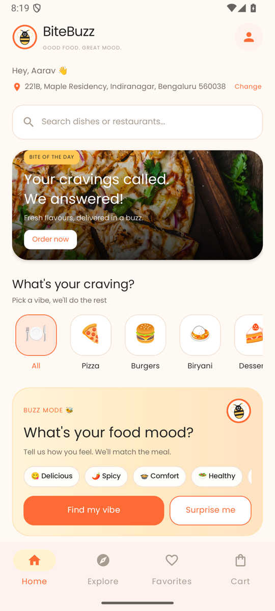
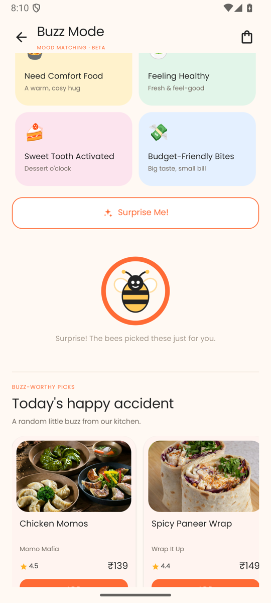
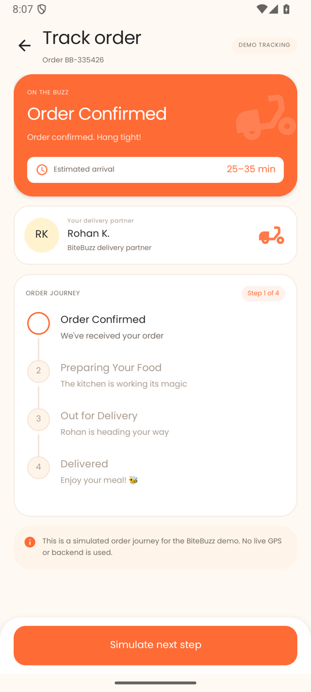

# BiteBuzz 🐝

**Good Food. Great Mood. All the Buzz.**

BiteBuzz is a local-only Android food-ordering demo built with Java and XML. It covers a complete browse → customize → cart → checkout → track flow, along with a mood-based recommendation feature called **Buzz Mode**.

<p align="center">
  
  
  
</p>

## Features

- **Home** — address editing, category shortcuts, quick bites, restaurant cards, and a featured offer.
- **Explore** — search dishes and restaurants, filter for vegetarian food, and sort by price or rating.
- **Food details** — quantity controls, add-ons, cooking instructions, favourite toggle, and live pricing.
- **Cart** — quantity controls, coupon support, free-delivery progress, and an order summary.
- **Checkout** — saved address, cash/UPI/card payment selection, and a rotation-safe order placement flow.
- **Order confirmation & tracking** — generated order IDs, animated confirmation, and simulated delivery steps.
- **Buzz Mode** — pick a food mood or tap **Surprise me** for a fresh set of recommendations.
- **Profile** — order history, favourites, saved bites, and account statistics.
- **Persistence** — cart, favourites, orders, address, and profile state survive app restarts.

## Tech stack

| Area | Used |
| --- | --- |
| Language | Java 11 |
| UI | XML layouts, Material 3, ViewBinding |
| AndroidX | AppCompat, Fragment, RecyclerView, ConstraintLayout |
| Build | Gradle Kotlin DSL, AGP 9.2.1, Gradle 9.4.1 |
| SDK | `compileSdk 36`, `minSdk 24`, `targetSdk 36` |
| Storage | `SharedPreferences` with local JSON serialization |

The app has no backend, network calls, API keys, or third-party services. All content is bundled sample data.

## Requirements

- A recent version of Android Studio that supports AGP 9.2.1
- JDK 21 (Android Studio's embedded JDK works)
- Android SDK Platform 36
- An emulator or device running Android 7.0 (API 24) or newer

## Run the app

### Android Studio

1. Open this repository's root folder in Android Studio.
2. Wait for Gradle sync to finish.
3. Start an emulator from **Device Manager** or connect a device with USB debugging enabled.
4. Select the **`app`** run configuration and click **Run ▶**.

The app launches through `SplashActivity` and then opens the Home screen.

> `MainActivity` is intentionally not exported. Keep the run configuration on **Default Activity** rather than launching `MainActivity` directly.

### Command line

```bash
# Build the debug APK
./gradlew :app:assembleDebug

# Install on a running emulator/device
./gradlew :app:installDebug

# Launch the app
adb shell am start -n com.example.bitebuzz/.SplashActivity
```

The debug APK is written to `app/build/outputs/apk/debug/app-debug.apk`.

## Tests and checks

```bash
# Unit tests
./gradlew :app:testDebugUnitTest

# Android lint
./gradlew :app:lintDebug

# Instrumented tests (requires a running emulator/device)
./gradlew :app:connectedDebugAndroidTest
```

## Project structure

```text
app/src/main/
├── java/com/example/bitebuzz/
│   ├── adapter/        RecyclerView adapters
│   ├── data/           Sample data, repository, SharedPreferences persistence
│   ├── fragment/       Home, Explore, Favorites, and Cart tabs
│   ├── model/          Food, restaurant, mood, cart, and order models
│   ├── util/           Price, UI, and dialog helpers
│   └── *.java          Activities and app flow
├── res/
│   ├── drawable*/      Icons, backgrounds, and food imagery
│   ├── layout/         Screen and item layouts
│   ├── values*/        Colors, dimensions, themes, strings, and plurals
│   └── xml/            Backup and data-extraction rules
└── AndroidManifest.xml
```

## Demo notes

- Use **BUZZ10** for 10% off the food subtotal, or **FIRSTBITE** for ₹30 off.
- Payments, delivery partners, and tracking updates are simulated for demonstration purposes.
- Clearing the app's data resets the cart, favourites, address, and order history.
- The UI is designed for both portrait and landscape orientations.

## License

No license has been added to this repository yet. Add one before distributing or accepting external contributions.
